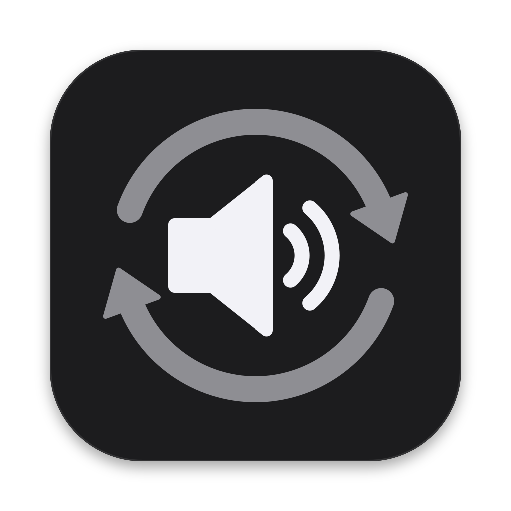

# SoundBlink

[Web サイト](https://takuhoito.github.io/SoundBlink/ja/) · [English](README.md)

USB オーディオの音割れ（ガビガビ音）を、出力先を一瞬だけ別のデバイスに切り替えてすぐ戻すことで解消する、macOS 用の小さなメニューバーアプリです。

## どんな問題か

一部の Mac で、USB 接続のオーディオ機器（スピーカー、DAC、ヘッドセットなど）の音が、しばらく使っているうちにガビガビ・バリバリと割れたり、プチプチとノイズが乗ったりすることがあります。モニターやドックの USB ハブ経由でつないでいる場合によく起きます。macOS Tahoe 以降、特に Apple Silicon の Mac で報告が増えています。出力先を一度内蔵スピーカーに切り替えて戻すと直りますが、しばらくするとまた起きます。

SoundBlink は、この「切り替えて戻す」操作を自動化します。

## できること

- **メニューバーのアイコンをクリックするとリセット**します。出力先を内蔵スピーカーに切り替え、元のデバイスの入出力が止まったのを確認したらすぐに戻します。このとき CoreAudio が元のデバイスの入出力を開き直すので、音割れが直ります。音が途切れるのは、たいてい 0.2 秒ほどです。切り替えている間、内蔵スピーカーはミュートにするので、本体から音は漏れません。
- 内蔵スピーカーがもともと出力先になっているときは何もしません。
- **定期リセット**（10 / 30 / 60 分ごと）。ON/OFF を切り替えられます。デフォルトでは、再生中はスキップします。
- **スリープ復帰時のリセット**（オプション）。
- **自動でリセットするデバイスを選べます**。最初は外部の出力デバイスがすべて対象です。チェックを外したデバイスは、定期リセットとスリープ復帰時のリセットをしません。アイコンをクリックすれば、そのデバイスでもリセットできます。
- **ログイン時に起動**。
- 表示は英語と日本語に対応しています。

内蔵スピーカーがない Mac では、ほかの出力デバイスを経由して切り替えます。その場合は、ミュートできる物理デバイスを優先して選びます。

## インストール

1. [最新のリリース](https://github.com/takuhoito/SoundBlink/releases/latest)から [`SoundBlink.zip`](https://github.com/takuhoito/SoundBlink/releases/latest/download/SoundBlink.zip) をダウンロードして展開し、`SoundBlink.app` を `/Applications` に移動します。
2. まだ公証（notarization）を受けていないので、初回起動は Gatekeeper にブロックされます。一度開こうとしたあと、**システム設定 → プライバシーとセキュリティ** で **「このまま開く」** を押してください。ターミナルで次のコマンドを実行しても開けるようになります。
   ```sh
   xattr -dr com.apple.quarantine /Applications/SoundBlink.app
   ```
3. メニューバーのアイコンを右クリックし、**「ログイン時に起動」** をオンにします。

macOS 13 Ventura 以降で動きます。Apple Silicon と Intel の両方に対応したユニバーサルアプリです。

## 使い方

| 操作                       | 動作           |
| -------------------------- | -------------- |
| クリック                   | 今すぐリセット |
| 右クリック / Control+クリック | メニューを開く |

メニューには次の項目があります。

- 今すぐリセット
- 定期リセット（間隔も選べます）
- 再生中はスキップ
- スリープ復帰時にリセット
- 自動リセットの対象: 定期リセットとスリープ復帰時のリセットをしないデバイスのチェックを外します。チェックを外したデバイスは、つないでいないときも一覧に残ります。
- ログイン時に起動
- 現在の出力先と、前回のリセット結果

### コマンドライン

アプリ本体はコマンドラインツールとしても使えます。ショートカット.app（「シェルスクリプトを実行」）、Raycast、Stream Deck などから呼び出せます。

```sh
/Applications/SoundBlink.app/Contents/MacOS/SoundBlink --reset   # 1回リセットする
/Applications/SoundBlink.app/Contents/MacOS/SoundBlink --list    # 出力デバイスの一覧を表示する
```

### 詳細設定

```sh
# 元のデバイスが止まったあと、経由先のデバイスにとどまる秒数（デフォルトは 0.05）
# リセットしても音割れが直らないときは、この値を大きくしてみてください
defaults write io.github.takuhoito.soundblink blinkHold -float 0.3
# 元のデバイスが止まるのを待つ最大の秒数。過ぎたら止まっていなくても戻す（デフォルトは 1.0）
defaults write io.github.takuhoito.soundblink blinkTimeout -float 2
# 定期リセットの間隔（分）を任意の値にする
defaults write io.github.takuhoito.soundblink intervalMinutes -int 15
```

変更したあとはアプリを再起動してください。デバイスごとに自動リセットが有効かどうかは、`--list` の出力で確認できます。

## 制限事項

- アプリ側で出力デバイスを「システムのデフォルト」ではなく特定のデバイスに固定していると、そのアプリは自分の音声ストリームを開いたままにすることがあり、リセットが届きません。Zoom や Teams などの音声設定で、スピーカーを「システムのデフォルト」にしておいてください。
- リセットすると、音が少しだけ（たいてい 0.2 秒ほど）途切れます。別のアプリがデバイスを直接開いたままにしているとデバイスが止まらないので、`blinkTimeout` の時間が過ぎたら戻します。このとき、メニューには「デバイスは使用中のまま」と表示されます。
- 「再生中はスキップ」は、CoreAudio の「デバイスが使用中か」というフラグで判定しています。アプリによっては、音を出していないときもデバイスを使用中のままにします（音声を扱うページを開いているブラウザのタブや、ビデオ会議アプリなど）。その間は定期リセットがスキップされ続けるので、気になる場合はこのオプションをオフにしてください。
- SoundBlink は回避策です。根本的な原因は macOS か、USB の接続経路にあります。

## 根本原因の切り分け

- オーディオ機器をモニターやドックのハブ経由ではなく、Mac 本体に直接つないで、再発するか確かめてください。
- USB マイクと USB スピーカーのように、USB オーディオ機器を 2 台同じ USB 2.0 ハブにつなぐのは避けてください。安価なハブの多くでは、低速な（Full-Speed の）機器がすべて 1 つのトランザクショントランスレータを共有します。
- USB 機器のつながり方は `system_profiler SPUSBHostDataType` で確認できます。
- SoundBlink のログは次のコマンドで見られます。
  `/usr/bin/log stream --predicate 'subsystem == "io.github.takuhoito.soundblink"'`

## ソースからビルドする

Xcode Command Line Tools（Swift 5.9 以降）が必要です。

```sh
git clone https://github.com/takuhoito/SoundBlink.git
cd SoundBlink
scripts/build-app.sh               # build/SoundBlink.app と build/SoundBlink-<version>.zip を作る
ARCHS=arm64 scripts/build-app.sh   # Apple Silicon 向けだけを速くビルドする
swift run SoundBlink --list        # アプリにまとめずに CLI だけ試す
```

アプリ名、bundle ID、バージョンは `scripts/config.sh` で設定します。

アイコンの元データは SVG で、`Resources/AppIcon.svg` と `Resources/StatusIcon.svg` にあります。SNS などで表示されるプレビュー画像の元データは `Resources/SocialPreview.svg` です。SVG を編集したら、Mac で `scripts/make-icons.sh` を実行して、`AppIcon.icns`、`StatusIcon.pdf`、`site/assets/` の Web サイト用の画像を作り直してください（`brew install librsvg` で入る `rsvg-convert` が必要です）。

Web サイトは `site/` にある素の HTML です。`site/index.html` をブラウザで開くとプレビューできます。`main` に push すると、`.github/workflows/pages.yml` が GitHub Pages に公開します。

## コントリビュート

Issue や Pull Request を歓迎します。不具合を報告するときは、次の情報を添えてください。

- `SoundBlink --list` の出力
- Mac の機種と macOS のバージョン
- オーディオ機器のつなぎ方（本体に直結 / ハブ経由 / モニター経由）

## 支援

SoundBlink は無料です。役に立ったと思っていただけたら、[GitHub Sponsors](https://github.com/sponsors/takuhoito) から支援していただけるとうれしいです（もちろん任意です）。

## ライセンス

[MIT](LICENSE)。アプリアイコン、メニューバーのアイコン、プレビュー画像は、このプロジェクトのために描いたオリジナルの作品で、同じライセンスで提供します。
