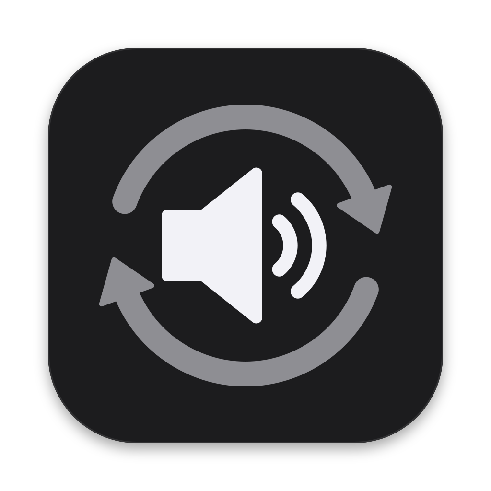

# SoundBlink

[Website](https://takuhoito.github.io/SoundBlink/) · [日本語](README.ja.md)

A tiny macOS menu bar app that clears crackling USB audio by "blinking" the
output to another device and straight back.

## The problem

On some Macs, USB audio devices (speakers, DACs, headsets, often connected
through a monitor or dock hub) start to crackle, pop or sound distorted after a
while. Reports have become common since macOS Tahoe, especially on Apple
silicon. Switching the output to the built-in speakers and back makes the noise
go away until the next time.

SoundBlink automates that workaround.

## What it does

- **Click the menu bar icon** to reset. The default output moves to the
  built-in speakers (muted, so nothing leaks out) and comes back as soon as
  your device has actually stopped. Core Audio restarts I/O on your device,
  which clears the distortion. The whole gap is typically around 0.2 seconds.
- Does nothing when the built-in output is already the default.
- **Periodic reset** every 10, 30 or 60 minutes, which you can turn on or off.
  By default it is skipped while audio is playing.
- **Reset after waking from sleep** (optional).
- **Choose which devices are reset automatically.** All external output
  devices are included by default. Uncheck a device to keep periodic and
  wake resets away from it; clicking the icon still resets it.
- **Launch at login.**
- English and Japanese UI.

If the Mac has no built-in output, SoundBlink switches through another output
device instead, preferring a physical device that it can mute.

## Install

1. Download [`SoundBlink.zip`](https://github.com/takuhoito/SoundBlink/releases/latest/download/SoundBlink.zip) from the
   [latest release](https://github.com/takuhoito/SoundBlink/releases/latest),
   unzip it and move `SoundBlink.app` to `/Applications`.
2. The app is not notarized yet, so Gatekeeper blocks the first launch. Open it
   once, then go to **System Settings → Privacy & Security** and click
   **Open Anyway**. Alternatively, run:
   ```sh
   xattr -dr com.apple.quarantine /Applications/SoundBlink.app
   ```
3. Right-click the menu bar icon and turn on **Launch at Login**.

SoundBlink requires macOS 13 Ventura or later. It is a universal app (Apple
silicon and Intel).

## Usage

| Action                      | Result         |
| --------------------------- | -------------- |
| Click                       | Reset now      |
| Right-click / Control-click | Open the menu  |

The menu contains:

- Reset Now
- Periodic Reset, with a choice of interval
- Skip While Audio Is Playing
- Reset After Waking from Sleep
- Auto-Reset Devices: uncheck the devices that periodic and wake resets should
  leave alone. Devices you unchecked stay listed while they are disconnected.
- Launch at Login
- The current output device and the result of the last reset

### Command line

The app binary also works as a command-line tool. You can call it from
Shortcuts ("Run Shell Script"), Raycast, Stream Deck and similar tools:

```sh
/Applications/SoundBlink.app/Contents/MacOS/SoundBlink --reset   # reset once
/Applications/SoundBlink.app/Contents/MacOS/SoundBlink --list    # list output devices
```

### Advanced settings

```sh
# Extra seconds to stay on the intermediate device after your device has
# stopped (default 0.05). Raise this if a reset does not clear the noise.
defaults write io.github.takuhoito.soundblink blinkHold -float 0.3
# Maximum seconds to wait for your device to stop before switching back
# anyway (default 1.0)
defaults write io.github.takuhoito.soundblink blinkTimeout -float 2
# Custom periodic interval in minutes
defaults write io.github.takuhoito.soundblink intervalMinutes -int 15
```

Restart the app after changing these. The `--list` output shows whether
automatic reset is on for each device.

## Limitations

- An app that is set to a specific output device, rather than the system
  default, may keep its own stream open, and the reset will not reach it. Set
  that app's speaker to the system default (for example in the audio settings
  of Zoom or Teams).
- A reset interrupts audio briefly, typically for around 0.2 seconds. If
  another app keeps your device open directly, the device cannot stop, and
  SoundBlink switches back after `blinkTimeout`. The menu then reports
  "device stayed busy".
- "Skip While Audio Is Playing" relies on Core Audio's "device is running"
  flag. Some apps keep the device running even when they are silent (for
  example, browser tabs that hold an audio context, or video-call apps). While
  they do, periodic resets keep getting skipped. Turn the option off if that
  happens.
- SoundBlink is a workaround. The root cause is in macOS or in the USB path.

## Finding the root cause

- Connect the audio device directly to the Mac instead of through a monitor or
  dock hub, and see whether the problem comes back.
- Avoid putting two USB audio devices, such as a USB microphone and USB
  speakers, on the same USB 2.0 hub. On many inexpensive hubs, all full-speed
  devices share a single transaction translator.
- `system_profiler SPUSBHostDataType` shows how your USB devices are connected.
- SoundBlink's log:
  `/usr/bin/log stream --predicate 'subsystem == "io.github.takuhoito.soundblink"'`

## Building from source

The Xcode command line tools (Swift 5.9 or later) are required.

```sh
git clone https://github.com/takuhoito/SoundBlink.git
cd SoundBlink
scripts/build-app.sh               # build/SoundBlink.app and build/SoundBlink-<version>.zip
ARCHS=arm64 scripts/build-app.sh   # faster, Apple silicon only
swift run SoundBlink --list        # quick CLI run without building the app bundle
```

The app's name, bundle ID and version are set in `scripts/config.sh`.

The icons are drawn as SVG in `Resources/AppIcon.svg` and
`Resources/StatusIcon.svg`, and the social preview image in
`Resources/SocialPreview.svg`. After editing them, run `scripts/make-icons.sh`
on a Mac to regenerate `AppIcon.icns`, `StatusIcon.pdf` and the website images
in `site/assets/` (this needs `rsvg-convert` from `brew install librsvg`).

The website is plain HTML in `site/`. Open `site/index.html` in a browser to
preview it. Changes pushed to `main` are published to GitHub Pages by
`.github/workflows/pages.yml`.

## Contributing

Issues and pull requests are welcome. When you report a problem, please
include:

- the output of `SoundBlink --list`
- your Mac model and macOS version
- how the audio device is connected (directly, through a hub, through a monitor)

## Support

SoundBlink is free. If it helps you and you would like to say thanks, you
can [sponsor me on GitHub](https://github.com/sponsors/takuhoito). It is
entirely optional.

## License

[MIT](LICENSE). The app icon, the menu bar icon and the social preview image
are original artwork made for this project, and they are covered by the same
license.
